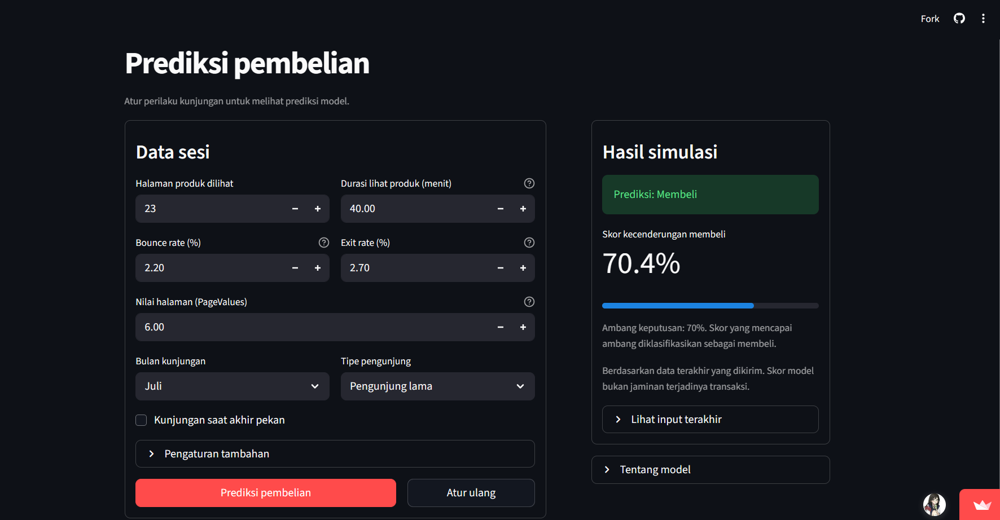

# E-Commerce Customer Behavior & Purchase Prediction

Proyek machine learning untuk memprediksi pembelian berdasarkan karakteristik sesi pengunjung menggunakan **Online Shoppers Purchasing Intention Dataset**. Proyek ini mengeksplorasi cara memprioritaskan sesi yang berpotensi berakhir dengan pembelian.

Alur proyek mencakup audit data, EDA, perbandingan model, penanganan ketidakseimbangan kelas, cross-validation, tuning, pemilihan threshold, interpretasi SHAP, dan aplikasi simulasi Streamlit.

**[Buka Live Demo](https://ecommerce-purchase-prediction-jcvwvic3azeby9hf266ebw.streamlit.app/)** · **[Ringkasan Proyek](docs/project_summary.md)**

## Demo Aplikasi



Aplikasi menerima karakteristik sesi pengunjung dan menampilkan skor kecenderungan membeli serta prediksi berdasarkan threshold **0,7**. Demo menggunakan pipeline tersimpan dan tidak melakukan training ulang.

Jika aplikasi sedang tidur, klik **“Yes, get this app back up!”** pada halaman Streamlit, lalu tunggu aplikasi dimuat.

## Dataset dan Pembagian Data

Dataset berisi **12.330 sesi**, **17 fitur**, dan target **`Revenue`**: `0` untuk tidak membeli dan `1` untuk membeli. Sekitar 15,5% sesi berakhir dengan pembelian, sehingga distribusi target tidak seimbang.

| Bagian | Jumlah sesi | Sesi pembelian |
|---|---:|---:|
| Training | 7.406 | 1.183 |
| Validation | 2.454 | 370 |
| Test | 2.470 | 355 |

Kelompok pola fitur ditempatkan pada bagian yang sama untuk mencegah pola identik tersebar antarbagian. Kelompok dibentuk tanpa menggunakan target dan `PageValues`. Tidak ada kelompok yang tumpang tindih antara training, validation, dan test.

[Sumber dataset: UCI Machine Learning Repository](https://archive.ics.uci.edu/dataset/468/online+shoppers+purchasing+intention+dataset)

## Eksperimen dan Metode

- Membandingkan **Logistic Regression, Random Forest, XGBoost, dan CatBoost**, dengan dan tanpa `PageValues`.
- Menggunakan **DummyClassifier** sebagai pembanding dasar.
- Menguji **class weighting** dan **SMOTENC** pada Random Forest, serta **`scale_pos_weight`** pada XGBoost.
- Melakukan tuning XGBoost menggunakan lima fold **StratifiedGroupKFold** pada bagian training.
- Melatih preprocessing hanya pada training atau training fold; kategori menggunakan one-hot encoding, sedangkan CatBoost menangani kategori secara native.
- Menghitung bobot kelas otomatis hanya dari target training yang sedang digunakan.
- Memilih threshold melalui validation dan mencatat konfigurasi, metrik, pipeline, serta laporan melalui **Weights & Biases (W&B)**.

## Model yang Digunakan Aplikasi

Aplikasi menggunakan **XGBoost dengan seluruh 17 fitur dan pembobotan kelas**, dari run `d9n08p0g`.

| Konfigurasi | Nilai |
|---|---:|
| `n_estimators` | 300 |
| `max_depth` | 3 |
| `learning_rate` | 0,03 |
| `scale_pos_weight` | 6.223 / 1.183 ≈ 5,26 |
| Threshold keputusan | 0,7 |
| Perangkat | CPU |

Threshold 0,7 memberikan F1 tertinggi di antara threshold yang diuji untuk model berbobot pada validation. Hasilnya juga merupakan F1 validation tertinggi pada tabel perbandingan eksperimen yang telah dilakukan.

| Metrik validation | Hasil |
|---|---:|
| Precision | 0,6040 |
| Recall | 0,7378 |
| F1 | **0,6642** |
| Average Precision | 0,7390 |
| ROC-AUC | 0,9324 |

Pada validation, model menandai **452 dari 2.454 sesi (18,4%)** dan mendeteksi **273 dari 370 sesi pembelian (73,8%)**. Terdapat 179 kesalahan positif dan 97 pembelian yang terlewat.

Hasil ini menunjukkan potensi untuk memprioritaskan sesi pengunjung. Peningkatan penjualan atau penghematan biaya promosi belum dibuktikan melalui eksperimen bisnis.

**Catatan:** metrik di atas berasal dari validation setelah pemilihan threshold. Model berbobot ini belum memiliki hasil test independen yang dilaporkan.

- [Run training model berbobot — metrik dicatat pada threshold awal 0,3](https://wandb.ai/elsaelisa/ecommerce-purchase-prediction/runs/d9n08p0g)
- [Evaluasi threshold model berbobot — pilihan threshold 0,7](https://wandb.ai/elsaelisa/ecommerce-purchase-prediction/runs/83s5lg90)

## Riwayat Evaluasi Test Model Awal

Sebelum pengembangan lanjutan, **XGBoost awal** dari run `u1b7ipvz`, dengan `scale_pos_weight=1` dan threshold **0,3**, telah dievaluasi pada test.

| Metrik test model awal | Hasil |
|---|---:|
| Precision | 0,6107 |
| Recall | 0,7690 |
| F1 | 0,6808 |
| Average Precision | 0,7325 |
| ROC-AUC | 0,9347 |

Angka ini merupakan riwayat model awal dan tidak mewakili model berbobot yang digunakan aplikasi sekarang. Hasil test dan validation tersebut berasal dari model dan subset berbeda, sehingga tidak digunakan sebagai perbandingan langsung untuk menentukan model terbaik.

[Evaluasi test model awal di W&B](https://wandb.ai/elsaelisa/ecommerce-purchase-prediction/runs/y333ouof)

## Menjalankan Demo Secara Lokal

Pengembangan awal menggunakan **Python 3.10**, Miniconda, dan CPU. Aktifkan environment Python yang sesuai, lalu jalankan perintah berikut dari folder utama proyek.

Pasang dependensi:

```powershell
python -m pip install -r requirements.txt
```

Demo membaca konfigurasi dari:

```text
configs/weighted_candidate_selection.yaml
```

Untuk konfigurasi tersebut, pipeline yang digunakan adalah:

```text
outputs/d9n08p0g/pipeline.joblib
```

Pipeline ini disertakan dalam repository. Salinan model juga tersedia pada artifact dari [run training model berbobot](https://wandb.ai/elsaelisa/ecommerce-purchase-prediction/runs/d9n08p0g).

Jalankan aplikasi:

```powershell
python -m streamlit run app.py
```

Demo memuat file lokal dan tidak memerlukan login W&B saat digunakan.

## Menjalankan Training

Pastikan file berikut tersedia:

- `data/raw/online_shoppers_intention.csv`
- `data/splits/split_manifest.csv`

Sesuaikan model dan parameter pada `configs/experiment.yaml`, kemudian jalankan:

```powershell
wandb login
python -m src.main
```

Pipeline disimpan pada `outputs/<run_id>/pipeline.joblib`. Konfigurasi dan hasil validation dicatat ke W&B.

Konfigurasi training dan konfigurasi aplikasi memiliki fungsi berbeda. Pada eksperimen berbobot yang disertakan, training mencatat evaluasi pada threshold 0,3, sedangkan aplikasi menggunakan threshold pilihan 0,7 dari `configs/weighted_candidate_selection.yaml`.

## Notebook

| Notebook | Isi |
|---|---|
| [01_data_audit_eda.ipynb](01_data_audit_eda.ipynb) | Audit data, pembentukan kelompok, pembagian data, dan EDA |
| [02_model_comparison.ipynb](02_model_comparison.ipynb) | Perbandingan hasil validation dan threshold |
| [03_shap_interpretation.ipynb](03_shap_interpretation.ipynb) | Interpretasi SHAP model awal |
| [04_model_development.ipynb](04_model_development.ipynb) | Cross-validation, tuning, CatBoost, dan pembobotan XGBoost |

Sebagian notebook membaca riwayat eksperimen melalui W&B. Pipeline historis selain model aplikasi dapat diunduh dari artifact run terkait jika diperlukan.

## Interpretasi dan Batasan

- Eksperimen tanpa `PageValues` menunjukkan penurunan performa yang besar. Ketersediaan fitur ini pada waktu prediksi perlu diperiksa sebelum penerapan real-time.
- Analisis SHAP yang tersimpan pada notebook 03 masih menjelaskan **model awal** dan menunjukkan kontribusi dominan `PageValues`. Analisis untuk model berbobot perlu dilengkapi agar sesuai dengan model aplikasi.
- SHAP menjelaskan perilaku model, bukan hubungan sebab-akibat atau dampak promosi terhadap transaksi tambahan.
- Skor dari model berbobot belum divalidasi sebagai probabilitas pembelian yang terkalibrasi.
- Test model awal sudah dilihat sebelum pengembangan lanjutan. Penilaian generalisasi model terbaru sebaiknya dilengkapi dengan data evaluasi baru yang independen.
- Dampak terhadap konversi dan margin bisnis perlu diukur melalui eksperimen, misalnya A/B testing.

Ringkasan lebih lanjut tersedia di [docs/project_summary.md](docs/project_summary.md).
